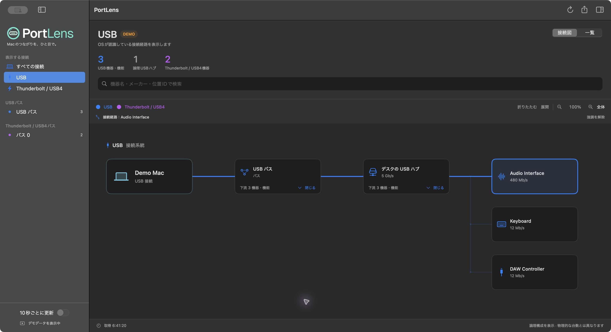
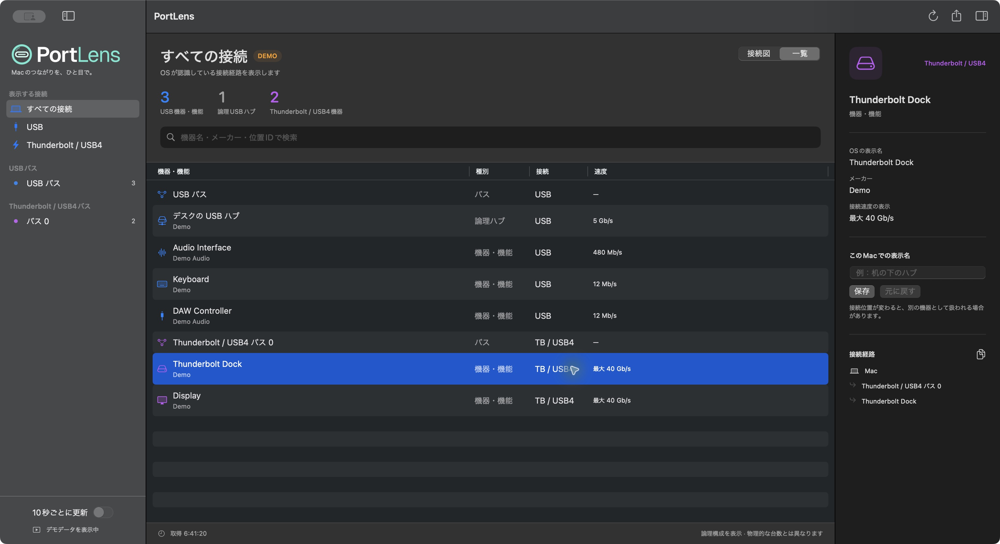

# PortLens

<picture>
  <source media="(prefers-color-scheme: dark)" srcset="Resources/Brand/portlens-lockup-dark.svg">
  
</picture>

**Macのつながりを、ひと目で。**

## 概要

PortLensは、Macに接続されたUSB・Thunderbolt／USB4機器を、接続図と一覧で確認するmacOSアプリです。macOSが認識している機器情報を読み取り、どのハブやバスにつながっているかを表示します。

- USB・Thunderbolt／USB4の接続図と機器一覧を切り替える
- 接続図を拡大・縮小し、ハブやバスの下流を折りたたむ
- 起動時は読みやすい100%表示。「全体」で表示領域に収まる倍率に自動調整する
- USBとThunderboltを横並びで表示し、共通の幹から分岐する線で接続を追う
- 機器を選択すると、その機器までの接続経路を強調表示する
- 詳細パネルは機器選択時に表示し、接続図の空白クリックで選択と詳細表示を解除する
- 接続方式やバスで絞り込み、機器名・メーカー・位置ID・自分で付けた表示名を検索する
- 機器を選んでメーカー、接続速度、位置IDなどを確認する
- 「机の下のハブ」などの表示名を付け、接続経路をコピーする
- 更新ボタン、または任意の自動更新で接続状態を再取得する
- 前回の取得から増減した論理ノード数を確認する
- スナップショットをJSONで書き出す
- デモデータで、機器を接続せずに表示を試す

表示は最後に取得した時点のスナップショットです。自動更新は初期状態ではオフです。「10秒ごとに更新」をオンにすると、10秒待ってから情報を再取得し、この処理を繰り返します。取得中の処理は重複実行しません。抜き差しした直後は更新するか、次の自動更新を待ってください。

外部Swiftパッケージ、Webサーバー、アカウント登録は不要です。データの取得・表示・書き出しはMac内で完結します。詳細は[安全性とプライバシー](docs/安全性とプライバシー.md)を参照してください。図はOSが報告する論理的な接続関係であり、物理ポート位置の推測やUSBとThunderboltの自動統合はありません。詳細は[表示の制限](docs/表示の制限.md)を参照してください。

デモデータを使って撮影したアプリの実画面です。実際の機器接続状況を表すものではありません。

**接続図** — USBバスとハブの下流を展開し、選択した機器までの接続経路を強調表示しています。



**機器一覧と詳細** — USB・Thunderbolt／USB4機器をまとめて表示し、選択した機器のメーカー・速度・接続経路を確認できます。



## 技術スタック

- 言語: Swift 5.9以降
- UI: SwiftUI / AppKit
- ビルド: Swift Package Manager（外部Swiftパッケージなし）
- 対象OS: macOS 14 Sonoma以降
- 接続情報: macOS標準の`system_profiler`（固定引数）
- 検証: `PortLensChecks`（Command Line Tools可） / XCTest（フル版Xcode）
- CI: GitHub Actions（macos-14）

## セットアップ

### 動作環境

- macOS 14 Sonoma以降
- ビルドにはSwift 5.9以降を含むXcode、またはCommand Line Tools for Xcode
- `swift test`でのXCTest実行にはフル版Xcodeが必要。Command Line Toolsのみの環境でもアプリのビルドと共通検証コマンドを利用可能

Command Line Toolsが未導入なら、ターミナルで次を実行してAppleのインストール画面を進めます。

```sh
xcode-select --install
```

### ダウンロード

**[PortLens 0.1.0をダウンロード（macOS 14以降・Universal版）](https://github.com/bassmicrobe/PortLens/releases/download/v0.1.0/PortLens-0.1.0-universal.zip)**

AppleシリコンとIntel Macの両方に対応しています。ZIPを展開し、`PortLens.app`をApplicationsフォルダにコピーして起動してください。XcodeやCommand Line Toolsのインストールは不要です。

[リリースノート](https://github.com/bassmicrobe/PortLens/releases/tag/v0.1.0) · [SHA-256チェックサム](https://github.com/bassmicrobe/PortLens/releases/download/v0.1.0/PortLens-0.1.0-SHA256SUMS.txt)

配布版はアドホック署名付きで、Developer ID署名とAppleの公証はまだ行っていません。初回起動時にmacOSが開発元を確認できない旨を表示する場合があります。入手元とチェックサムを確認し、必要に応じて[Appleの公式案内](https://support.apple.com/ja-jp/102445)を参照してください。

### ソースからビルド

```sh
git clone https://github.com/bassmicrobe/PortLens.git
cd PortLens
./scripts/build-app.sh
open dist/PortLens.app
```

`dist/PortLens.app`に、ビルドしたMacと同じCPUアーキテクチャのアプリが生成されます。AppleシリコンとIntel Macの両方に対応する場合は`./scripts/build-app.sh --universal`を使います。デバッグ構成は`./scripts/build-app.sh --debug`です。普段使う場合はFinderでApplicationsフォルダなどにコピーできます。

スクリプトはローカル実行用のアドホック署名を付けます。Developer ID署名・Appleの公証・Mac App Store向けのサンドボックス設定は含みません。他のMacへ配布する場合は、配布方法に合わせた署名と権限の検証が必要です。

開発中は次の方法でも起動できます。

```sh
swift run PortLens
```

配布用のUniversal版ZIPとSHA-256チェックサムを作る場合は、次を実行します。出力先は`dist/releases/`です。

```sh
./scripts/package-release.sh
```

### 検証

Command Line Toolsのみの環境では、XCTestに依存しない共通検証コマンドを使います。

```sh
swift run PortLensChecks
swift build --product PortLens
```

フル版Xcodeを開発環境として選択している場合は、同じ検証処理をXCTestから実行できます。

```sh
swift test
```

`no such module 'XCTest'`と表示される場合は、`xcode-select -p`で選択中の開発環境を確認してください。Command Line Toolsのみの場合は`swift run PortLensChecks`を使うか、フル版Xcodeを導入・選択します。CIでは共通検証コマンドとXCTestの両方を実行します。

パーサーのテストは合成データで実行するため、特定のUSB機器を接続しておく必要はありません。実機との接続確認には`--snapshot`、画面の確認には通常起動または`--demo`を使います。

SVGを更新した場合は、`swift scripts/generate-icon.swift`でアプリアイコンと画面用PDFを再生成し、`./scripts/build-app.sh`でアプリをビルドし直してください。生成済みのファイルもリポジトリに含まれるため、通常のビルドで再生成する必要はありません。ロゴのSVG原本は`Resources/Brand/`に保存しています。READMEとアプリのサイドバーは、明暗それぞれの背景に合わせたロゴを使います。`portlens-appicon.svg`から生成したアイコンをDock・Finderで使用します。

## 使い方

1. 左のサイドバーで「すべての接続」「USB」「Thunderbolt / USB4」、または個別のバスを選びます。
2. 「接続図」「一覧」を切り替えます。機器が多い環境では、初めはバスが折りたたまれます。「展開」、またはカードの展開ボタンから下流を確認できます。
3. 右の詳細パネルは機器を選んだときだけ表示されます。接続図の空白をクリックすると選択が解除され、詳細パネルも閉じます。「このMacでの表示名」に別名を入力して保存できます。OSや機器本体の名前は変更しません。
4. ツールバーの更新ボタンで情報を再取得し、書き出しボタンでJSONを保存できます。

接続図は100%の大きさで起動し、USBとThunderboltを横並びに表示します。画面に収まらない部分は縦・横にスクロールできます。「全体」を押すと自動調整モードになり、ウィンドウや詳細パネルのサイズ変更、検索・展開・折りたたみに合わせて、図全体が収まる倍率を再計算します。拡大・縮小ボタンを押すと手動モードになり、その後のサイズ変更では選んだ倍率を維持します。倍率表示をクリックすると100%に戻ります。

| 操作 | ショートカット |
|---|---|
| 接続情報を更新 | `⌘R` |
| JSONを書き出す | `⇧⌘S` |
| 選択中の機器の詳細パネルを切り替える | `⌥⌘I` |

デモ表示は実際の接続状態を表しません。

```sh
swift run PortLens --demo
```

利用できるオプションを確認する場合は、`swift run PortLens --help`を実行します。

GUIを開かずに機器情報を取得し、JSONを標準出力へ書き出すこともできます。

```sh
swift run PortLens --snapshot
```

ファイルに保存する例です。`snapshots/`はGitの追跡対象から除外しています。

```sh
mkdir -p snapshots
swift run PortLens --snapshot > snapshots/mac.snapshot.json
```

## 構成

```text
Sources/
  PortLens/             SwiftUIアプリ、画面と状態管理
    Resources/          明暗それぞれの背景用ロゴ（PDF）
  PortLensCore/         接続情報の取得・解析・モデル
  PortLensChecks/       Command Line Toolsでも実行できる検証ランナー
Tests/
  PortLensValidation/   接続ツリー、入力検証、プライバシーなどの共通検証
  PortLensCoreTests/    共通検証のXCTestラッパー
Resources/
  Info.plist            アプリバンドル情報
  AppIcon.icns          アプリアイコン
  Brand/                提供されたオリジナルのSVGロゴ一式
scripts/
  build-app.sh          .appの生成
  package-release.sh    Universal版ZIPとチェックサムの生成
  generate-icon.swift   SVGからアイコン・画面用ロゴを生成
docs/
  images/               スクリーンショット
  releases/             リリースノート
```

## ドキュメント

- [v0.1.0 リリースノート](docs/releases/v0.1.0.md)
- [安全性とプライバシー](docs/安全性とプライバシー.md)
- [表示の制限](docs/表示の制限.md)
